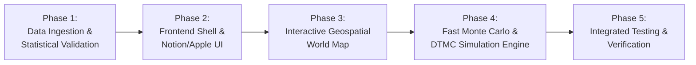

# Interactive Coral Reef Health and Bleaching Simulation: Implementation Plan
**A Stochastic and Inferential Forecasting Platform for Marine Ecosystem Dynamics**
*Applied Statistics and Stochastic Processes (ASSP)*

---

## 1. Executive Summary & Objective

The objective is to build an interactive, data-driven simulation platform modeling coral bleaching and mortality across a 50-year forecast horizon on a global scale. 

The application couples empirical environmental data from `global_bleaching_environmental.csv` (41,361 survey records across 12,702 reef sites) with rigorous mathematical stochastic modeling:
1. **Discrete-Time Markov Chain (DTMC)** with dynamic environmental transition probabilities.
2. **Monte Carlo Simulation Engine** computing expected multi-path survival trajectories and confidence bounds over 50 years.
3. **Multiple Linear Regression (OLS)** estimating empirical sensitivities ($\hat{\boldsymbol{\beta}}$) of bleaching severity to sea surface temperature anomalies and degree heating weeks.
4. **Chi-Square ($\chi^2$) Test of Independence** evaluating environmental factor dependence (turbidity/pollution and depth) to parameterize conditional multipliers.

The user interface follows a **Notion & Apple-inspired aesthetic**: minimalist typography, subtle border lines, neutral slate palette, zero AI decorations/sparkles/streaming text, divided into a **50/50 split layout** (Interactive Global Heatmap on the left, Control Panel & Stochastic Dashboard on the right).

---

## 2. Mathematical & Statistical Specification

### 2.1 Discrete-Time Markov Chain (DTMC) & Dynamic Transitions

* **State Space ($\mathcal{S}$):**
  $$\mathcal{S} = \{0: \text{Healthy}, 1: \text{Stressed}, 2: \text{Bleached}, 3: \text{Dead}\}$$
  State $3$ is an absorbing state representing permanent coral mortality and structural collapse.

* **Tridiagonal Row-Stochastic Transition Matrix ($P(t)$):**
  Transitions occur between adjacent states, with backward recovery allowed from states $1$ and $2$, and absorption at state $3$:
  $$P(t) = \begin{bmatrix} P_{00}(t) & P_{01}(t) & 0 & 0 \\ P_{10}(t) & P_{11}(t) & P_{12}(t) & 0 \\ 0 & P_{21}(t) & P_{22}(t) & P_{23}(t) \\ 0 & 0 & 0 & 1 \end{bmatrix}$$

* **Dynamic Probability Link (Logistic / Sigmoid Function):**
  Degradation probabilities ($P_{01}, P_{12}, P_{23}$) are dynamic logistic functions of thermal stress $x_1 = \text{TSA\_DHW}$ and local turbidity $x_2 = \text{Turbidity}$, modulated by depth and exposure modifiers:
  $$P_{i, i+1}(t) = \sigma\left(\gamma_i + \beta_1 x_1(t) + \beta_2 x_2(t) + \delta_{\text{depth}} + \delta_{\text{exposure}}\right) = \frac{1}{1 + e^{-(\gamma_i + \beta_1 x_1(t) + \beta_2 x_2(t) + \delta_{\text{depth}} + \delta_{\text{exposure}})}}$$
  Where:
  - $\beta_1, \beta_2$ are directly parameterized by the empirical Multiple Linear Regression estimates from the dataset.
  - $\gamma_i$ are state-specific baseline activation thresholds ($\gamma_0 < \gamma_1 < \gamma_2$).
  - $\delta_{\text{depth}}$ provides deep-water thermal sheltering ($\delta_{\text{depth}} < 0$ for deep reefs).
  - $\delta_{\text{exposure}}$ reflects hydrodynamic wave flushing.

* **Recovery Probability Link ($P_{10}, P_{21}$):**
  Reversible recovery occurs when thermal stress recedes, augmented by Marine Protected Area (MPA) coverage and local water quality:
  $$P_{i, i-1}(t) = \rho_i \cdot \left(1 + \kappa_{\text{MPA}} \cdot \text{MPA\_Coverage}\right) \cdot \left(1 - \sigma\left(\alpha_{\text{rec}} x_1(t) + \beta_{\text{rec}} x_2(t)\right)\right)$$
  Where $\rho_i$ represents baseline calcification recovery rate.

* **Diagonal Probability Constraint:**
  Row stochasticity is strictly enforced at each time step $t$:
  $$P_{ii}(t) = 1 - \sum_{j \neq i} P_{ij}(t)$$

---

### 2.2 Monte Carlo Simulation Engine

* **Initial State Distribution ($\mathbf{\pi}_0$):**
  Each spatial reef node $k \in \{1, \dots, N\}$ initializes with state probabilities $\mathbf{\pi}_{0, k} = [\pi_0^{(0)}, \pi_0^{(1)}, \pi_0^{(2)}, \pi_0^{(3)}]$ derived from its historical `Percent_Bleaching` and survey record in `global_bleaching_environmental.csv`:
  - $\text{Percent\_Bleaching} < 10\% \implies \text{Healthy (0)}$
  - $10\% \le \text{Percent\_Bleaching} \le 30\% \implies \text{Stressed (1)}$
  - $30\% < \text{Percent\_Bleaching} \le 75\% \implies \text{Bleached (2)}$
  - $\text{Percent\_Bleaching} > 75\% \implies \text{Dead (3)}$

* **Trajectory Sampling:**
  For $M$ independent Monte Carlo paths over $N$ spatial reef locations and time horizons $t \in \{1, \dots, T\}$ ($T \le 50$ years):
  1. For current state $i = X_{k, t}^{(m)}$, evaluate row $i$ of $P_t$.
  2. Compute the cumulative distribution function (CDF): $F_{i, j} = \sum_{l=0}^j P_{il}(t)$ for $j \in \{0, 1, 2, 3\}$.
  3. Sample uniform pseudo-random variate $U_{k, t}^{(m)} \sim \text{Uniform}(0, 1)$.
  4. Determine the next state:
     $$X_{k, t+1}^{(m)} = \min \left\{ j \in \{0, 1, 2, 3\} : F_{i, j} \ge U_{k, t}^{(m)} \right\}$$

* **Expectation Projection & Credible Bounds:**
  The expected fraction of the ecosystem in state $s \in \{0, 1, 2, 3\}$ at year $t$ across $M$ Monte Carlo realizations is:
  $$\mathbb{E}[\text{State}_s(t)] = \frac{1}{M \cdot N} \sum_{m=1}^M \sum_{k=1}^N \mathbb{I}\left(X_{k, t}^{(m)} = s\right)$$
  Variance and empirical 95% confidence intervals are computed at each time step:
  $$\text{Var}[\text{State}_s(t)] = \frac{1}{M-1} \sum_{m=1}^M \left( \bar{X}_{s, t}^{(m)} - \mathbb{E}[\text{State}_s(t)] \right)^2$$
  $$\text{CI}_{95\%}(t) = \mathbb{E}[\text{State}_s(t)] \pm 1.96 \sqrt{\frac{\text{Var}[\text{State}_s(t)]}{M}}$$

---

### 2.3 Multiple Linear Regression (OLS) Model

* **Model Formulation:**
  $$Y = \beta_0 + \beta_1 X_{\text{SSTA}} + \beta_2 X_{\text{TSA\_DHW}} + \epsilon, \quad \epsilon \sim \mathcal{N}(0, \sigma^2)$$
  - $Y$: `Percent_Bleaching` ($\in [0, 100]$)
  - $X_{\text{SSTA}}$: Sea Surface Temperature Anomaly ($^\circ\text{C}$)
  - $X_{\text{TSA\_DHW}}$: Degree Heating Weeks ($^\circ\text{C-weeks}$)

* **Ordinary Least Squares Parameter Estimation:**
  $$\hat{\boldsymbol{\beta}} = (\mathbf{X}^T \mathbf{X})^{-1} \mathbf{X}^T \mathbf{Y}$$
  *Calculated empirically on the dataset (34,393 clean records):*
  - $\hat{\beta}_0 = 7.5322$ (Baseline bleaching intercept)
  - $\hat{\beta}_1 = 0.8065$ (Thermal anomaly slope, $p < 10^{-15}$)
  - $\hat{\beta}_2 = 1.4741$ (Degree Heating Week accumulation slope, $p < 10^{-15}$)
  - Multiple $R^2 = 0.0750$, Overall $F = 1394.5$ ($p < 0.0001$)

* **Integration with DTMC:**
  The regression slopes directly calibrate the sensitivity coefficients $\beta_1$ and $\beta_2$ in the logistic hazard function:
  $$\beta_1 = \kappa_1 \cdot \hat{\beta}_1, \quad \beta_2 = \kappa_2 \cdot \hat{\beta}_2$$
  where $\kappa_1, \kappa_2$ are scaling constants mapping continuous bleaching percentage to log-odds hazard of state transition.

---

### 2.4 Chi-Square ($\chi^2$) Test of Independence

* **Hypotheses:**
  - $H_0$: Coral Bleaching Severity is independent of Local Turbidity (Pollution level).
  - $H_1$: Coral Bleaching Severity is dependent on Local Turbidity.

* **Binned Contingency Table Construction:**
  - Turbidity categorized into empirical tertiles from dataset:
    - Low Turbidity: $< 0.0442$
    - Medium Turbidity: $[0.0442, 0.0725]$
    - High Turbidity: $> 0.0725$
  - Bleaching Severity categorized into:
    - Mild / Healthy ($<10\%$)
    - Moderate / Stressed ($10\% - 50\%$)
    - Severe / Bleached ($>50\%$)

* **Empirical Test Results (from `global_bleaching_environmental.csv`):**
  - Observed Contingency Matrix ($3 \times 3$):
    $$\mathbf{O} = \begin{bmatrix} 8,270 & 1,722 & 791 \\ 9,139 & 1,399 & 556 \\ 9,296 & 1,241 & 415 \end{bmatrix}$$
  - Degrees of Freedom: $\nu = (r - 1)(c - 1) = (3 - 1)(3 - 1) = 4$
  - Test Statistic:
    $$\chi^2 = \sum_{i=1}^3 \sum_{j=1}^3 \frac{(O_{ij} - E_{ij})^2}{E_{ij}} = 271.95$$
  - Critical Value ($\alpha = 0.05$): $\chi^2_{0.05, 4} = 9.488$
  - Conclusion: $p\text{-value} < 10^{-50} \implies$ **Reject $H_0$ decisively**.

* **Stochastic Bridge Rule:**
  Because $H_0$ is rejected, a conditional pollution multiplier $w_{\text{pollution}}$ is applied to transition probabilities:
  $$P_{i, i+1}^{\text{polluted}} = \min\left(1.0, P_{i, i+1} \times (1 + w_{\text{pollution}} \cdot \text{Turbidity\_Level})\right)$$

---

## 3. Policy Intervention Scenarios & Secondary Drivers

The platform models three standardized climate trajectory scenarios across the 50-year horizon:

| Scenario | Temperature Trend ($\Delta T_t$) | MPA Conservation Impact | Recovery Rate ($\rho_i$) |
| :--- | :--- | :--- | :--- |
| **1. Business-As-Usual (RCP 8.5)** | Steady warming $+0.04^\circ\text{C}$ / year, compounding DHW spikes every 3–5 years | Minimal enforcement ($0\% - 15\%$) | Baseline, suppressed by chronic stress |
| **2. Moderate Action (RCP 4.5)** | Warming peaks at Year 25 ($+0.02^\circ\text{C}$ / year), then stabilizes | Moderate MPA coverage ($30\% - 50\%$) | Steady recovery during intermediate periods |
| **3. Aggressive Climate Action (1.5°C Paris)** | Warming capped within 10 years, stabilization & active cooling | High MPA protection ($70\% - 100\%$) | Enhanced recovery ($+40\%$), local pollution abatement |

**Secondary Factors:**
* **Reef Depth:** Deep reefs ($> 15\text{m}$) experience thermal attenuation and reduced UV stress, reducing transition hazards by up to $25\%$. Shallow reefs ($< 5\text{m}$) suffer heightened diurnal thermal fluctuations.
* **Hydrodynamic Exposure:** Exposed reefs benefit from upwelling and water flow, dispersing thermal build-up compared to stagnant sheltered lagoons.

---

## 4. Architecture & Technical Stack

```
┌────────────────────────────────────────────────────────────────────────┐
│                        DATA PREPROCESSING LAYER                        │
│  global_bleaching_environmental.csv (41,361 rows, 12,702 sites)       │
│  ├── Python OLS Engine (Calculates b0, b1, b2, R², F-stat)             │
│  ├── Chi-Square Engine (Calculates Contingency Table, χ², p-value)     │
│  └── Spatial Clustering (Extracts ~1,000 global representative reefs)  │
│      └── Generates: `public/data/reef_simulation_data.json`            │
└───────────────────────────────────┬────────────────────────────────────┘
                                    │ Pre-computed matrices & nodes
                                    ▼
┌────────────────────────────────────────────────────────────────────────┐
│                      INTERACTIVE FRONTEND CLIENT                       │
│                   (Vite + React + Tailwind CSS)                        │
│                                                                        │
│  ┌─────────────────────────────────┐ ┌───────────────────────────────┐ │
│  │      LEFT: GEOSPATIAL MAP       │ │     RIGHT: CONTROL PANEL      │ │
│  │                                 │ │                               │ │
│  │ • High-performance Leaflet/     │ │ • Sliders: Temp (TSA_DHW),   │ │
│  │   Canvas/WebGL Dot Renderer     │ │   Turbidity, Depth, Horizon   │ │
│  │ • 1,000 Global Reef Coordinates │ │ • Segmented Policy Selector   │ │
│  │ • Real-time State Colors:       │ │ • Live 4x4 DTMC Matrix        │ │
│  │   - Healthy: Emerald #10B981    │ │ • Monte Carlo Trajectory Plot │ │
│  │   - Stressed: Amber #F59E0B     │ │ • OLS Parameter Readout       │ │
│  │   - Bleached: Coral #F43F5E     │ │ • Chi-Square Contingency Card │ │
│  │   - Dead: Slate #334155         │ │                               │ │
│  │ • Year Scrubber [0 ───●─── 50]  │ │ • Instant 60fps Vectorized    │ │
│  │ • Play/Pause/Speed Controls     │ │   Monte Carlo Engine in JS    │ │
│  └─────────────────────────────────┘ └───────────────────────────────┘ │
└────────────────────────────────────────────────────────────────────────┘
```

### High Performance Real-Time Engine
- The Monte Carlo trajectory engine is implemented as a vectorized simulation loop in JavaScript / Web Worker.
- Sliders run with zero network lag: dragging any slider instantly updates the $4 \times 4$ Markov matrix, re-evaluates the 50-year expectation curves in $< 5\text{ms}$, and updates the map dots synchronously.
- Map supports playback animation from Year 0 to Year 50 with smooth state transitions.

---

## 5. UI/UX Design System: Notion & Apple-Inspired

### Visual Language & Aesthetic Rules
- **Palette:** Strict monochrome and neutral slate foundations (`bg-[#fafafa]`, cards in `#ffffff`, borders in `#e5e7eb` or `#262626` for dark mode).
- **Accents:** Semantic state colors only (Emerald, Amber, Coral, Charcoal Slate). No neon gradients.
- **Typography:** Apple system fonts (`-apple-system, BlinkMacSystemFont, "SF Pro Text", "Inter", sans-serif`), clear tabular numbers (`font-mono font-medium`).
- **Layout:** Crisp split-screen (50% geospatial visualization, 50% analytical dashboard).
- **Controls:** Apple-style segmented buttons, continuous slider thumbs with numerical readouts, discreet toggle switches.

### Strict Negative Constraints Compliance
The application **will not** include any of the following:
* ❌ NO sparkles or gradients (✨)
* ❌ NO streaming text / typewriter effect
* ❌ NO inline floating selection menus ("Ask AI")
* ❌ NO thumbs up/down or regenerate buttons
* ❌ NO inline citations or footnotes badges
* ❌ NO thinking/process collapsible disclosure logs
* ❌ NO prompt editing or branching controls
* ❌ NO starter chips or prompt suggestion buttons
* ❌ NO context pins or memory reference pills
* ❌ NO draft & approval preview dialogs

---

## 6. Implementation Phases



### Phase 1: Data Ingestion & Statistical Validation
1. Create a Python extraction pipeline (`scripts/process_coral_data.py`).
2. Run exact OLS regression on 34,393 records to compute $\hat{\boldsymbol{\beta}}$, $R^2$, $F$, $p$-values.
3. Compute full $3 \times 3$ Chi-Square contingency table, $\chi^2$ statistic, and $p$-value for Turbidity $\times$ Bleaching severity.
4. Cluster 12,702 reef sites into ~1,000 globally representative spatial nodes preserving real coordinates, ocean realm, historical bleaching level, depth, baseline TSA_DHW, and turbidity.
5. Export structured JSON: `reef_simulation_data.json` and `statistical_model.json`.

### Phase 2: Application Shell & Clean UI System
1. Initialize Vite + React + Tailwind CSS environment.
2. Build 50/50 split-screen layout with Notion/Apple typography, refined borders, and card components.
3. Implement slider controls for continuous stressors (Temperature Anomaly, TSA_DHW, Turbidity).
4. Implement segmented controls for Policy Scenarios (Business as Usual, Moderate Action, Aggressive Climate Policy).
5. Implement dropdowns/toggles for Depth categories, Exposure levels, and MPA coverage slider.

### Phase 3: Geospatial Heatmap & Timeline Player
1. Integrate Leaflet / Canvas high-density point renderer with minimalist cartographic tiles.
2. Render ~1,000 reef sites across Pacific, Atlantic, Indian, Red Sea, Caribbean, and Coral Triangle.
3. Map color-coding: Healthy (`#10B981`), Stressed (`#F59E0B`), Bleached (`#F43F5E`), Dead (`#334155`).
4. Build timeline scrubber (Year 0 to Year 50) with Play / Pause / Reset / Speed (1x, 2x, 5x) controls.
5. Add hover inspection card for individual reef patches displaying site name, coordinates, ocean, depth, and live state probability.

### Phase 4: DTMC Engine & Live Analytical Dashboard
1. Implement client-side dynamic Markov transition matrix generator ($P(t)$) linked to slider inputs.
2. Implement Monte Carlo multi-path trajectory sampler ($M$ iterations over 50 years).
3. Build **Live $4 \times 4$ Transition Matrix Preview** showing exact probabilities with row-sum validation.
4. Build **50-Year Trajectory Chart** (using clean line/area charts) with mean curves and 95% confidence bands.
5. Build **OLS Regression Diagnostics Card** showing empirical equation, coefficients, and input contributions.
6. Build **Chi-Square Hypothesis Test Card** showing observed vs. expected counts, test statistic ($\chi^2 = 271.95$), and the active pollution multiplier status ($w_{\text{pollution}}$).

### Phase 5: Verification & Quality Assurance
1. Verify mathematical consistency:
   - Row-stochastic condition $\sum_j P_{ij} = 1.0$ at all slider values.
   - Absorbing state condition $P_{33} = 1.0, P_{3j} = 0$.
   - OLS and Chi-Square outputs match empirical calculations.
2. Ensure 60fps rendering and instant (<5ms) response when dragging controls.
3. Verify compliance with all negative constraints (no AI fluff, pure scientific tool).

---

## 7. Deliverables
* Fully functional, interactive web application running locally via Vite.
* Preprocessed data asset derived from `global_bleaching_environmental.csv`.
* Verified statistical parameters, matrix calculations, and Monte Carlo engine.
* Comprehensive documentation and user guide.
